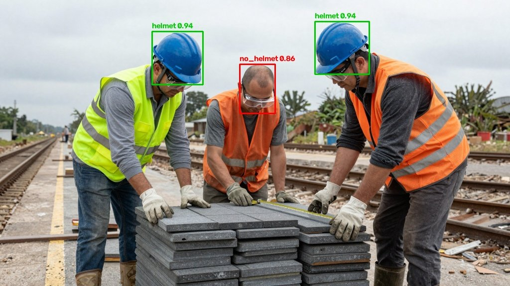
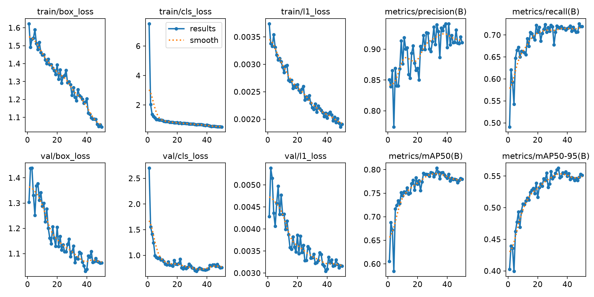
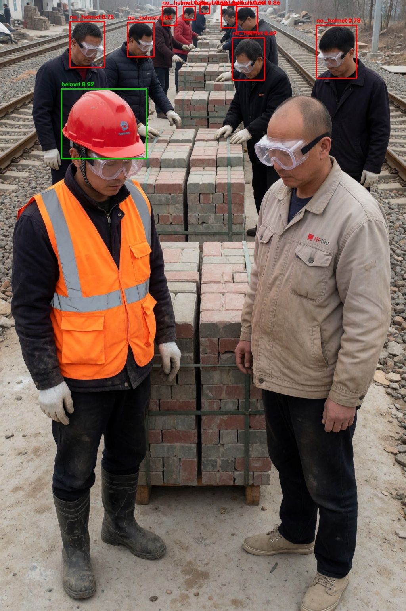

# cpu-helmet-detection

GPU 없이 **일반 노트북 CPU**에서 실시간으로 동작하는 **안전모 착용 감지 AI** (진행 중)

카메라 영상에서 사람의 머리를 찾아 **안전모를 썼는지(helmet) / 안 썼는지(no_helmet)** 를 구분합니다.



> 초록 박스 = helmet(착용), 빨간 박스 = no_helmet(미착용), 숫자 = 모델의 확신도(0~1)

---

## 진행 상황

| 단계 | 내용 | 상태 |
|---|---|---|
| 1 | YOLO로 안전모 착용/미착용 학습 + 웹캠 데모 (`1_train/`) | ✅ 완료 |
| 2 | OpenVINO / ONNX로 CPU 최적화, 속도 비교 (`2_optimize/`) | 🔄 진행 중 (변환·속도·정확도 비교 완료) |
| 3 | 위험 구역 경고 시스템 (`3_alert_system/`) | ⏳ 예정 |

---

## 1단계 결과: 모델 학습

### 학습 환경
| 항목 | 값 |
|---|---|
| CPU | AMD Ryzen 5 5600 6코어 (GPU 사용 안 함) |
| 소프트웨어 | Python 3.13, PyTorch 2.15 (CPU), Ultralytics 8.4.212 |
| 모델 | YOLO26n (Ultralytics, nano 크기, 파라미터 약 239만 개) |
| 학습 방법 | 사전학습 모델에서 시작하는 전이학습, 50에폭, 이미지 크기 640 |
| 학습 시간 | 약 2시간 28분 (CPU만 사용) |

### 성능 (검사용 사진 200장)
| 클래스 | Precision (정밀도) | Recall (재현율) | mAP50 | mAP50-95 |
|---|---|---|---|---|
| helmet | 0.924 | 0.827 | **0.880** | 0.693 |
| no_helmet | 0.923 | 0.603 | **0.709** | 0.439 |
| 전체 | 0.924 | 0.715 | **0.794** | 0.566 |

- **Precision (정밀도)**: 모델이 "찾았다"고 한 것 중 실제로 맞은 비율
  (높을수록 엉뚱한 곳에 박스를 덜 그림)
- **Recall (재현율)**: 실제 정답 중 모델이 찾아낸 비율
  (높을수록 놓치는 사람이 적음)
- **mAP (mean Average Precision, 평균 정밀도)**: 물체 감지 모델의 대표 점수 (0~1, 1에 가까울수록 좋음)
  - 확신도 기준을 높게도 낮게도 바꿔 가며 정밀도와 재현율을 함께 평가한 점수가 **AP**이고,
    이것을 클래스(helmet, no_helmet)별로 구해 평균 낸 것이 **mAP**입니다.
  - 그래서 "정확하게 찾는가"와 "빠뜨리지 않고 찾는가"를 한 숫자로 볼 수 있습니다.
- **IoU (겹침 정도)**: 모델이 그린 박스와 정답 박스가 얼마나 겹치는지 (0~1)
  - **mAP50**: IoU가 0.5 이상(절반 이상 겹침)이면 맞힌 것으로 계산한 mAP
  - **mAP50-95**: IoU 기준을 0.5, 0.55, … 0.95까지 점점 엄격하게 바꿔 가며 계산한 mAP의 평균
    (박스 위치까지 정확해야 높게 나와서 mAP50보다 낮게 나옴)

1에폭 학습 후 mAP50 0.606에서 50에폭 학습 후 **0.794**로 올랐습니다.
helmet(0.880)보다 no_helmet(0.709) 점수가 낮고, 특히 no_helmet의 Recall(0.603)이 낮아 미착용자를 놓치는 경우가 있습니다.

### 속도 (최적화 전 기준값, PyTorch CPU)
| 측정 | 결과 |
|---|---|
| 검사용 사진 1장 추론 시간 (200장 측정) | 약 23~32 ms (중앙값 25.6 ms) |
| 웹캠 데모 FPS (실제 웹캠 영상, 모델 추론 시간만 측정) | 약 35~36 FPS (2회 측정: 35.2 / 36.2 FPS, 1장 평균 28.4 / 27.6 ms) |

→ 2단계에서 OpenVINO / ONNX로 바꾼 뒤 이 값과 비교할 예정입니다.

### 학습 그래프


- 검사용 데이터의 박스 손실(val/box_loss)이 끝까지 함께 줄어들어, 큰 과적합(학습 데이터만 외우는 현상)은 보이지 않습니다.
- 다만 mAP는 **30에폭 무렵부터 더 오르지 않았고**, 검사용 분류 손실(val/cls_loss)은 35에폭 이후 조금 올라갔습니다.
  → 에폭을 더 늘리기보다 데이터를 늘리는 쪽이 성능 개선에 효과적일 것으로 보입니다.
- 저장된 `best.pt`는 학습 중 점수가 가장 좋았던 에폭의 모델입니다.

### 결과 예시 (여러 명이 있는 장면)


> 오른쪽 앞의 **안전모를 안 쓴 사람(가까이 있어 크게 찍힌 얼굴)은 찾지 못했습니다.** 멀리 있는 작은 머리는 잘 찾지만, 가까운 큰 얼굴은 놓치는 한계를 보여 주는 예시입니다. (아래 한계점 2번 참고)
> 결과 사진은 확신도 0.4 이상 박스만 표시했습니다. 전체 성능은 위 표를 참고하세요.

---

## 2단계 결과: CPU 최적화 (진행 중)

1단계에서 학습한 모델(`best.pt`)을 **ONNX**와 **OpenVINO** 형식으로 바꾸고, 같은 조건에서 CPU 속도를 비교했습니다.

- **ONNX**: 여러 프로그램에서 함께 쓸 수 있는 AI 모델 파일 형식 (ONNX Runtime으로 실행)
- **OpenVINO**: 인텔이 만든 CPU용 AI 가속 도구

### 속도 비교 (AMD Ryzen 5 5600, 검사용 사진 200장 × 3회)
| 모델 형식 | 1장 추론 시간 (중앙값) | FPS | 회차별 평균 (ms) | PyTorch 대비 |
|---|---|---|---|---|
| PyTorch (원래 모델) | 26.5 ms | 37.7 | 28.0 / 27.3 / 27.6 | 1.00배 |
| ONNX | 21.1 ms | 47.5 | 21.1 / 21.1 / 21.0 | **1.26배** |
| OpenVINO | **16.6 ms** | **60.3** | 16.6 / 16.9 / 16.5 | **1.60배** |

- 모델 추론 시간만 측정했습니다. (사진 준비, 박스 정리 시간 제외 / FPS = 1000 ÷ 중앙값)
- 3회 측정의 차이가 0.4 ms 이내로 작아서, 형식 사이의 속도 차이는 측정 오차가 아닌 실제 차이입니다.
- **OpenVINO는 인텔이 만든 도구지만, AMD CPU에서도 1.6배 빨라졌습니다.**
### 정확도 비교 (검사용 사진 200장, 세 모델 모두 1장씩 채점)
| 모델 형식 | Precision | Recall | mAP50 | mAP50-95 | helmet mAP50 | no_helmet mAP50 |
|---|---|---|---|---|---|---|
| PyTorch (원래 모델) | 0.923 | 0.719 | **0.794** | 0.566 | 0.880 | 0.709 |
| ONNX | 0.926 | 0.718 | **0.793** | 0.564 | 0.878 | 0.708 |
| OpenVINO | 0.926 | 0.718 | **0.793** | 0.564 | 0.878 | 0.708 |

- 전체 mAP50 차이는 **0.001**로, 형식을 바꿔도 정확도는 사실상 그대로입니다.
- ONNX와 OpenVINO는 같은 FP32(32비트 소수) 계산이라 점수가 완전히 같았습니다.
- PyTorch와의 아주 작은 차이는 계산 순서에 따른 소수점 끝자리 차이와, 변환 모델이 사진을 항상 640×640 정사각형으로 맞춰 넣는 차이 때문입니다.

### 2단계 핵심 결과
| | PyTorch | OpenVINO |
|---|---|---|
| 1장 추론 시간 | 26.5 ms | **16.6 ms (1.60배 빠름)** |
| 정확도 (mAP50) | 0.794 | **0.793 (거의 같음)** |

→ **OpenVINO로 바꾸면 정확도는 그대로 두고 CPU에서 1.6배 빨라집니다.**

### 측정하면서 발견한 함정: 처음 결과는 과장되어 있었다
처음에는 한 프로그램 안에서 세 모델을 차례대로 측정했고, **OpenVINO가 2.95배 빠르다**는 결과가 나왔습니다.
그런데 회차별 결과를 보니 이상한 점이 있었습니다.

| 회차 | 측정 순서 | PyTorch 평균 |
|---|---|---|
| 1회차 | **PyTorch** → ONNX → OpenVINO | 27.3 ms |
| 2회차 | ONNX → OpenVINO → **PyTorch** | 49.5 ms |
| 3회차 | OpenVINO → **PyTorch** → ONNX | 48.3 ms |

PyTorch는 ONNX·OpenVINO를 실행한 **뒤에만** 2배 가까이 느려졌습니다.
ONNX Runtime과 OpenVINO가 계산을 마친 뒤에도 일꾼(스레드)을 남겨 두면서 CPU를 함께 쓰게 되어,
같은 프로그램 안의 PyTorch가 방해를 받은 것으로 보입니다.

- 해결: **모델 하나를 잴 때마다 새 프로그램(프로세스)을 띄워서** 서로 방해하지 않게 측정
- 결과: PyTorch가 모든 회차에서 27~28 ms로 일정해졌고, OpenVINO의 실제 속도 향상은 **1.60배**였습니다.
- 배운 점: 속도 비교는 숫자 하나만 보지 말고 **여러 번, 순서를 바꿔 가며** 재고, 회차별 결과가 일정한지 확인해야 한다.

---

## 한계점과 개선 계획

1. **no_helmet을 놓치는 경우가 있음** (Recall 0.603)
   - 미착용 데이터가 착용 데이터의 절반 정도로 적음 (학습용 박스 634개 vs 1,282개)
   - 개선: 미착용 데이터 추가, 이미지 크기 키우기, 더 큰 모델(yolo26s) 비교
2. **웹캠 앞 가까운 얼굴은 잘 못 찾음 (도메인 차이)**
   - 학습 데이터는 대부분 멀리서 찍은 공사 현장 사진이라 머리가 작게 나옴
   - 검사용 사진 예시: 앞쪽에 크게 찍힌 미착용자를 확신도 0.05까지 낮춰도 찾지 못함 (위 결과 예시)
   - 이전 모델의 웹캠 실험: 웹캠 앞에 가까이 앉으면 박스가 안 뜨고, 2~3m 떨어지면 감지됨.
     정면 각도의 맨머리를 no_helmet으로 감지한 경우도 있었으나 확신도는 약 0.5로 낮았음 (새 모델로 다시 확인 예정)
   - 개선: 정면·근거리 사진이 많은 데이터셋(예: Hard Hat Workers) 추가 학습
3. **박스 깜박임**
   - 매 화면을 따로 판단해서 확신도가 기준선 근처면 박스가 켜졌다 꺼졌다 함
   - 해결: 최근 박스를 몇 장 동안 유지하는 스무딩 적용 (`webcam.py --hold`)

---

## 실행 방법 (Windows)

### 1. 설치
```bash
py -3.13 -m venv .venv
.\.venv\Scripts\python.exe -m pip install ultralytics opencv-python
```

### 2. 데이터셋 내려받기
```bash
.\.venv\Scripts\python.exe 1_train\download_dataset.py
```
- `datasets/construction-ppe` 에 원본을 내려받고, helmet / no_helmet 두 클래스만 남긴 `datasets/helmet` 을 만듭니다.

### 3. 학습
```bash
.\.venv\Scripts\python.exe 1_train\train.py --epochs 50
```
- 결과 모델: `runs/helmet/weights/best.pt` (다시 학습하면 폴더 이름 뒤에 번호가 붙음)

### 4. 웹캠 데모
```bash
.\.venv\Scripts\python.exe 1_train\webcam.py
```
| 옵션 | 설명 |
|---|---|
| `--model 경로` | 사용할 모델 파일 (기본: `runs/helmet/weights/best.pt`) |
| `--source 경로` | 웹캠 대신 사진/영상 파일 사용 |
| `--conf 0.15` | 이 확신도보다 낮은 박스는 표시 안 함 (기본 0.4) |
| `--hold 10` | 박스가 사라져도 몇 장 동안 유지할지 (깜박임 줄이기) |

키보드: `s` 화면 저장(`images/`), `q` 또는 창의 X 버튼으로 종료

### 5. CPU 최적화 (2단계)
```bash
.\.venv\Scripts\python.exe -m pip install onnx onnxslim onnxruntime openvino
.\.venv\Scripts\python.exe 2_optimize\export.py
.\.venv\Scripts\python.exe 2_optimize\benchmark.py
.\.venv\Scripts\python.exe 2_optimize\accuracy.py
```
- `export.py`: `best.pt`를 ONNX(`best.onnx`)와 OpenVINO(`best_openvino_model/`)로 변환하고, 결과가 같은지 확인
- `benchmark.py`: 세 모델의 속도를 측정 (`--rounds 3` 반복 횟수, `--images 200` 사진 수)
- `accuracy.py`: 세 모델의 정확도(mAP)를 검사용 사진으로 채점해서 비교

---

## 폴더 구조
```
1_train/          모델 학습 코드
  download_dataset.py   데이터셋 내려받기 + helmet/no_helmet만 남기기
  train.py              YOLO26n CPU 학습
  webcam.py             웹캠/사진 데모
2_optimize/       CPU 최적화와 속도 비교
  export.py             ONNX / OpenVINO 변환 + 결과 확인
  benchmark.py          세 모델 속도 비교
  accuracy.py           세 모델 정확도(mAP) 비교
3_alert_system/   위험 구역 경고 시스템 (예정)
images/           README 결과 사진
```
데이터셋(`datasets/`), 학습 결과(`runs/`), 모델 파일(`*.pt`, `*.onnx`)은 용량 때문에 저장소에 올리지 않습니다.

---

## 데이터셋 출처와 라이선스

- **Construction-PPE** — Ultralytics
  - 문서: https://docs.ultralytics.com/datasets/detect/construction-ppe
  - 라이선스: **CC BY 4.0** (ultralytics 패키지의 `construction-ppe.yaml` 표기 기준)
  - 변경 사항: 12개 클래스 중 `helmet`, `no_helmet` 두 개만 사용
  - README의 결과 사진은 이 데이터셋의 검사용 사진에 모델 결과 박스를 그려 넣은 것입니다.

## 사용 기술
Python 3.13 · Ultralytics YOLO26 · PyTorch (CPU) · OpenCV · ONNX Runtime · OpenVINO
